<div align="center">

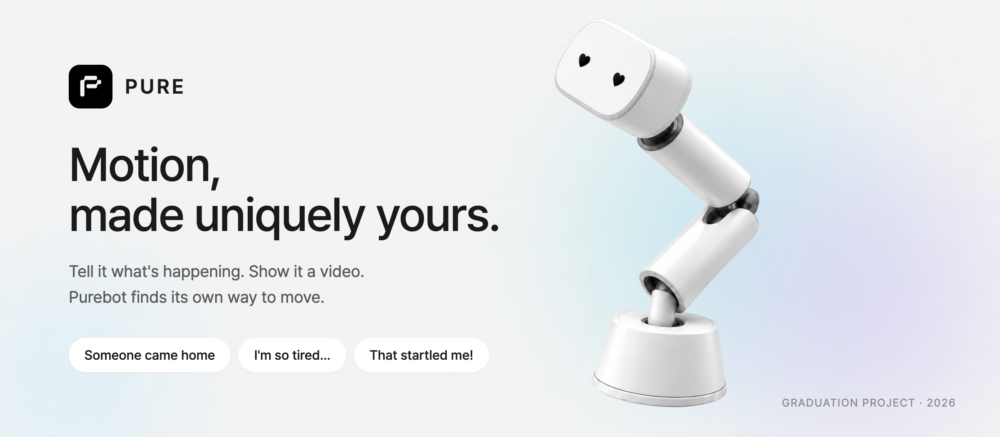

<br />

**상황을 말하거나 영상을 보여주면, AI가 로봇의 움직임을 만들고 — 물리 시뮬레이터가 그 자리에서 재생합니다.**

<br />


[소개](#-소개) · [화면](#-화면) · [움직임](#-purebot의-움직임) · [어떻게 동작하나](#-어떻게-동작하나) · [구조](#-아키텍처) · [실행하기](#-실행하기)

</div>

<br />

## ✦ 소개

**PURE**는 책상 위 로봇 **PURE Desk (Purebot)** 를 위한 모바일 앱입니다.
"누가 집에 왔어", "나 너무 피곤해…" 처럼 상황을 말하면, LLM이 그 순간에 어울리는 움직임을 만들고
앱 안에 들어 있는 **MuJoCo 물리 시뮬레이터**가 로봇을 실시간으로 움직여 보여줍니다.
마음에 들면 저장하고, *"누가 집에 오면 자동으로"* 같은 반응 상황에 연결해 둡니다.

그리고 모든 움직임에는 **모션 시그니처** — 내가 고른 로봇의 성격·관계·표현 방식 — 가 스며들어,
같은 "인사"라도 나만의 로봇다운 몸짓이 됩니다.

> 졸업전시 시연용 프로젝트입니다. 실제 로봇 통신 없이 시뮬레이터로 재생하며, 서버 없이 기기 안에서 동작합니다.

<table>
<tr>
<td width="25%" align="center">💬<br /><b>말로</b><br /><sub>상황 칩 · 텍스트 · 음성</sub></td>
<td width="25%" align="center">🎬<br /><b>영상으로</b><br /><sub>보여준 움직임을 따라 만들기</sub></td>
<td width="25%" align="center">🤖<br /><b>바로 재생</b><br /><sub>MuJoCo 물리 시뮬레이션</sub></td>
<td width="25%" align="center">📚<br /><b>저장 · 자동 반응</b><br /><sub>라이브러리 + 트리거</sub></td>
</tr>
</table>

<br />

## ✦ 화면

<div align="center">
<table>
<tr>
<td align="center">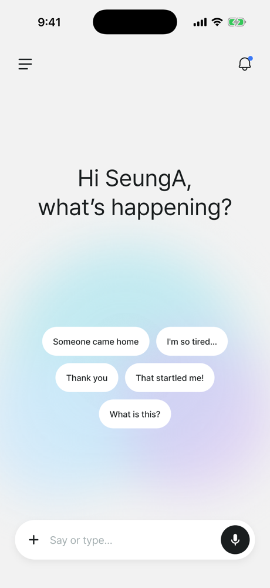<br /><sub><b>Home</b><br />"Hi SeungA, what's happening?"</sub></td>
<td align="center">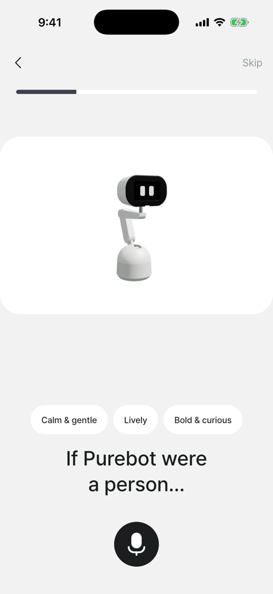<br /><sub><b>Motion Signature</b><br />고를 때마다 대기 모션이 바뀐다</sub></td>
<td align="center">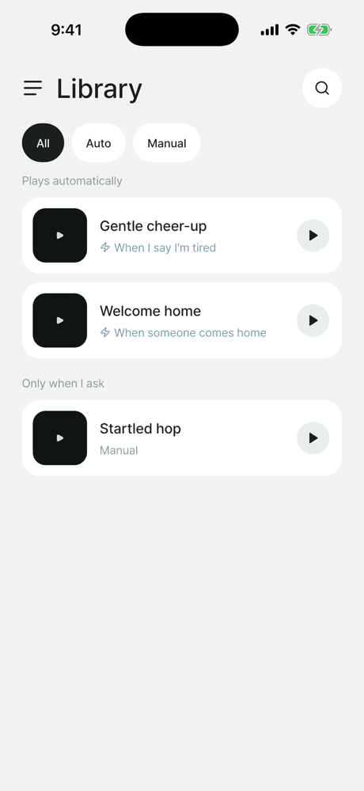<br /><sub><b>Library</b><br />자동 재생 · 수동 그룹</sub></td>
</tr>
<tr>
<td align="center">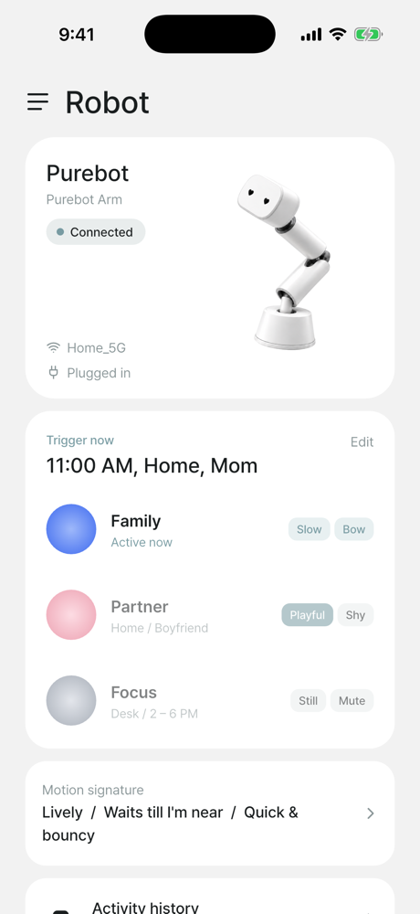<br /><sub><b>Robot</b><br />상태 · 모드 · 시그니처</sub></td>
<td align="center">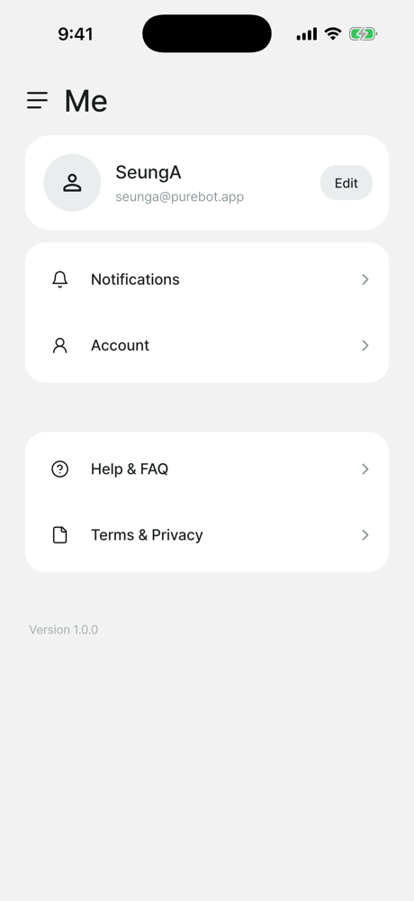<br /><sub><b>Me</b><br />프로필 · 설정</sub></td>
<td align="center">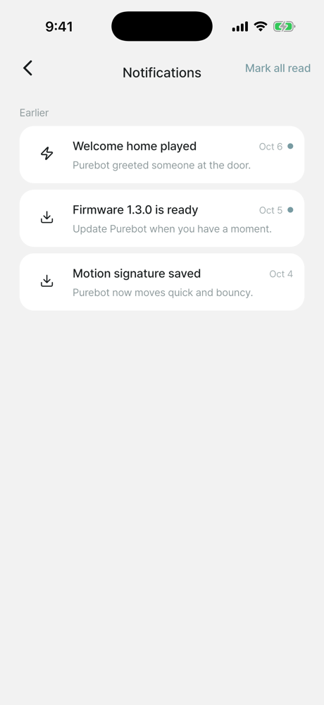<br /><sub><b>Notifications</b><br />로봇이 한 일</sub></td>
</tr>
</table>
</div>

<br />

## ✦ Purebot의 움직임

앱 안 시뮬레이터에서 직접 캡처한 장면입니다. 미리 검증된 **15가지 동작**과 **7가지 얼굴**을 LLM이 조합해 하나의 움직임을 만듭니다.

<div align="center">
<table>
<tr>
<td align="center">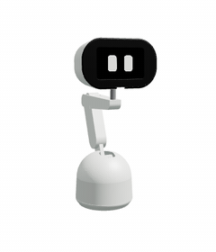<br /><code>greet</code></td>
<td align="center">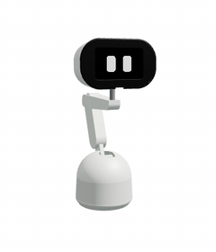<br /><code>happy</code></td>
<td align="center">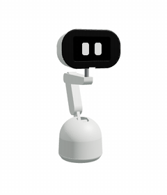<br /><code>curious</code></td>
</tr>
<tr>
<td align="center"><br /><code>look_around</code></td>
<td align="center"><br /><code>nod</code></td>
<td align="center"><br /><code>sleep</code></td>
</tr>
</table>

<sub>idle · doze · sleep · wake · nod · shake · look_around · curious · happy · sad · alert · greet · sweep · focus · home</sub>

<br /><br />

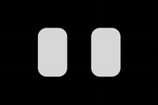&nbsp;
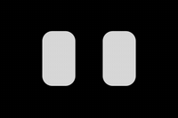&nbsp;
&nbsp;
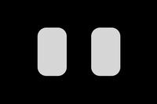&nbsp;
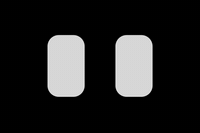&nbsp;
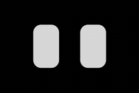&nbsp;
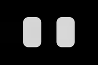

<sub><code>neutral</code> · <code>smile</code> · <code>heart</code> · <code>sad</code> · <code>sleepy</code> · <code>surprise</code> · <code>tilt</code></sub>
</div>

<br />

## ✦ 어떻게 동작하나

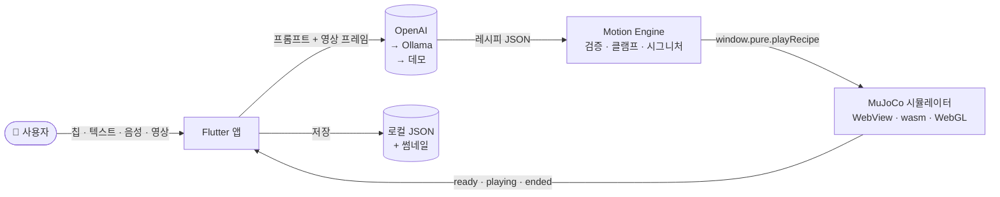

LLM은 관절 값을 직접 만들지 않습니다. 대신 검증된 동작을 조합한 **레시피**를 만듭니다.

```jsonc
// "Someone came home" → Purebot의 인사
{
  "steps": [
    { "behavior": "wake" , "speed": 1.1 },
    { "behavior": "greet", "speed": 1.15, "amplitude": 1.1, "repeat": 2, "face": "smile" },
    { "behavior": "happy", "speed": 1.1, "face": "heart" }
  ]
}
```

<details>
<summary><b>설계에서 지킨 다섯 가지</b></summary>

<br />

| | 원칙 | 내용 |
|---|---|---|
| 1 | **LLM 출력은 반드시 검증** | 최대 6단계 · 동작/얼굴은 허용 목록만 · 속도·크기·반복은 범위로 클램프 (`MotionEngine`) |
| 2 | **시연 경로는 죽지 않는다** | OpenAI → 로컬 모델(Ollama) → 데모 레시피 3단 폴백. 키 없음·오프라인·크레딧 소진에도 로봇은 움직인다 |
| 3 | **시뮬레이터는 봉인된 모듈** | Flutter와의 접점은 `sim/src/api.ts`의 `window.pure` 하나. WebView는 앱 전체에 1개 (wasm 컴파일 비용) |
| 4 | **시그니처가 개성을 만든다** | 성격·관계·표현 방식이 재생 속도·진폭 배율, 대기 모션, 인사 전 동작으로 번역되어 모든 생성에 곱해진다 |
| 5 | **서버가 없다** | 기기 안 JSON 파일로 저장. 영상·프레임은 API 전송 외에는 앱 밖으로 나가지 않는다 |

</details>

<details>
<summary><b>모션 시그니처 옵션</b></summary>

<br />

| Personality | Relationship | Motion |
|---|---|---|
| Calm & gentle | Comes to me first | Quick & bouncy |
| Lively | Waits till I'm near | Slow & smooth |
| Bold & curious | Only when needed | In between |

</details>

<br />

## ✦ 아키텍처

```
lib/
├── screens/       화면 (Home · Signature · Library · Robot · Me …)
├── widgets/       Figma 디자인 시스템을 번역한 공용 컴포넌트
├── theme/         색 · 타이포 · 간격 · 모션 토큰
├── providers/     상태 (Provider / ChangeNotifier)
├── services/
│   ├── generation/   GenerationClient — OpenAI · Ollama · Demo
│   └── …             MotionEngine · 영상 프레임 추출 · 음성 입력
├── repositories/  LocalRepository (원자적 JSON 저장)
├── sim/           WebView 브리지 — SimHost · SimController
└── data/          칩 · 질문 트리 · 반응 상황 · 동작 허용 목록 · 데모 레시피 · 문구

sim/               Vite + TypeScript 시뮬레이터 (MuJoCo wasm + Three.js)
└── src/api.ts     window.pure — Flutter와의 유일한 계약
```

더 자세한 문서는 [`docs/architecture/`](docs/architecture/README.md)에 있습니다 —
[시스템 구조](docs/architecture/01-system-architecture.md) ·
[데이터 흐름](docs/architecture/02-data-flow-diagram.md) ·
[시퀀스](docs/architecture/03-sequence-diagram.md) ·
[기능 구조](docs/architecture/04-functional-architecture.md)

<br />

## ✦ 실행하기

**필요한 것** — Flutter (Dart ^3.12) · Xcode · Node.js

```bash
# 1. 시뮬레이터 웹 번들 빌드 → assets/sim/
./scripts/build_sim.sh

# 2. (선택) OpenAI 키 설정 — 없으면 데모 모드로 동작합니다
cp .env.local.example .env.local   # OPENAI_API_KEY 채우기

# 3. iOS 시뮬레이터에서 실행
./scripts/dev.sh run
```

| 명령 | 설명 |
|---|---|
| `./scripts/dev.sh run` | 시뮬레이터에 띄우고 핫리로드 |
| `./scripts/dev.sh install` | 빌드해서 설치만 |
| `./scripts/install_device.sh` | 릴리스 빌드를 연결된 아이폰에 설치 |
| `flutter test` | 테스트 209개 (모션 엔진 · 생성 폴백 · 저장소 · 영상 · 음성 · 통합 · 위젯) |

> 🔑 OpenAI 키는 `--dart-define`으로만 주입되며 코드·커밋·로그에 남지 않습니다. `.env.local`은 git에서 제외됩니다.
> 같은 Wi-Fi의 Mac에서 Ollama를 띄우면 `OLLAMA_HOST`로 로컬 모델을 2차 생성 경로로 씁니다.

<br />

## ✦ 만든 과정

로직을 먼저 회색 박스로 완성해 동결(`v0.1-logic`)한 뒤, Figma 디자인을 토큰 기반 위젯으로 번역하는 순서로 만들었습니다.

```
로직   1 스캐폴드 → 2 sim 추출 → 3 브리지 → 4 모델·콘텐츠 → 5 저장·상태 → 6 시그니처·모션 엔진
       → 7 GPT 생성 + 데모 → 8 영상 입력 → 9 음성 입력 → 10 회색박스 → 11 통합 테스트
디자인 20 토큰 → 21 폰트·아이콘 → 22 Figma 화면 번역 → 23 폴리시 → 24 연출 → 25 마감·실기기
```

모든 설계 결정은 [`docs/decisions.md`](docs/decisions.md)에 한 줄씩 기록했습니다.

<br />

<div align="center">


<sub><b>PURE</b> — Motion, made uniquely yours.<br />Graduation Project · 2026</sub>

</div>
