<div align="center">


<br/><br/>

# PURE <sub>App</sub>

### Motion, made uniquely yours.

**상황을 말하거나 영상을 보여주면, AI가 로봇의 움직임을 만들고 — 앱 안의 물리 시뮬레이터가 그 자리에서 재생해요.**

책상 위 로봇 **PURE Desk (Purebot)** 를 위한 iOS 앱이에요.<br/>
"누가 집에 왔어", "나 너무 피곤해…" 한마디가 내 로봇만의 몸짓 · 표정이 돼요.

<br/>

[](https://flutter.dev)
[](ios)
[](sim)
[](sim/package.json)
[](https://threejs.org)
[](https://mujoco.org)
[](lib/config/env.dart)
[](lib/services/generation/ollama_client.dart)


<sub>Team PURE · 전승아 SeungA Jeon · 최성근 Seonggeun Choi · 방태림 Taerim Bang</sub>

<br/>

**📱 App** (지금 보는 저장소) · **🖥️ [Expert Lab (웹)](https://github.com/cherrymixy/pure-web)** — 기업 · 디자이너가 로봇과 브랜드 모션체를 설계하는 시뮬레이션 웹

</div>

> **시연용 안내** — 졸업전시 시연용 프로젝트예요. 실제 로봇과 통신하지 않고 앱 안의 시뮬레이터로 재생하며, 서버 없이 기기 안에서 동작해요. OpenAI 키가 없으면 로컬 모델(Ollama) → 데모 레시피 순서로 대신 동작해요.

---

<div align="center">

> ### “일상에서 마주친 매력적인 움직임을, 바로 내 로봇의 모션체로.”
> 웹이 로봇을 **설계하는** 곳이라면, 앱은 사용자가 로봇과 **함께 지내며 개성을 키우는** 곳이에요.

</div>

---

## 📑 목차

[**기획**](#-기획--왜-pure인가) · [**모션 시그니처**](#-모션-시그니처) · [**시나리오**](#-시나리오--for-user) · [**주요 기능**](#-주요-기능) · [**화면**](#-화면) · [**Purebot의 움직임**](#-purebot의-움직임) · [**파이프라인**](#-파이프라인) · [**아키텍처**](#-아키텍처) · [**기술 스택**](#-기술-스택) · [**설계 결정**](#-설계-결정) · [**시작하기**](#-시작하기) · [**출처**](#-출처--오픈소스) · [**팀**](#-팀)

---

## 🎯 기획 — 왜 PURE인가

2030년에는 누구나 집에서 로봇을 만나게 될지도 몰라요. 그런데 모든 로봇이 똑같이 말하고, 똑같이 움직이고, 똑같이 표현한다면 — 거기서 개성을 느낄 수 있을까요?

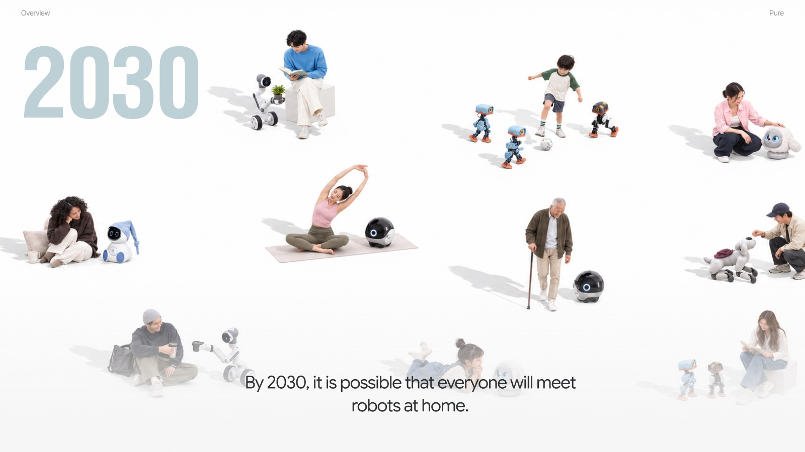


정확한 실행이라는 기능적인 움직임 말고도, 꾸벅꾸벅 졸고 꼼지락거리고 분위기를 읽는 움직임이 있어요. 목적이나 효율에서 잠깐 벗어난 이 순수한 움직임을 우리는 **PURE**라고 불러요.


> 시장 · 디자인 시스템 · 가이드라인까지 담은 전체 기획은 [Expert Lab (웹) README](https://github.com/cherrymixy/pure-web#-기획--왜-pure인가)에 있어요.

---

## ✍️ 모션 시그니처

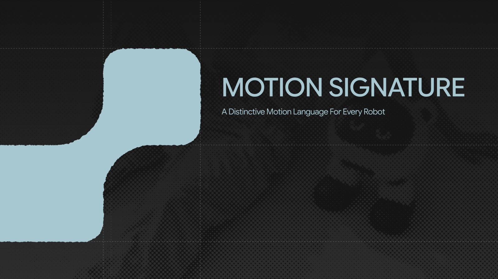

사람의 개성이 **글씨체**에 드러나듯, 로봇의 개성은 **모션체**에 드러나요.

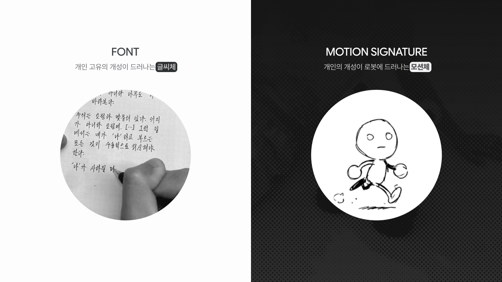

앱에서는 세 가지 질문으로 내 로봇의 모션 시그니처를 정해요. 고를 때마다 시뮬레이터의 대기 모션이 바로 바뀌고, 이후 만드는 모든 움직임에 성격 · 관계 · 표현 방식이 곱해져요.

| Personality | Relationship | Motion |
|---|---|---|
| Calm & gentle | Comes to me first | Quick & bouncy |
| Lively | Waits till I'm near | Slow & smooth |
| Bold & curious | Only when needed | In between |

---

## 🎬 시나리오 — For User

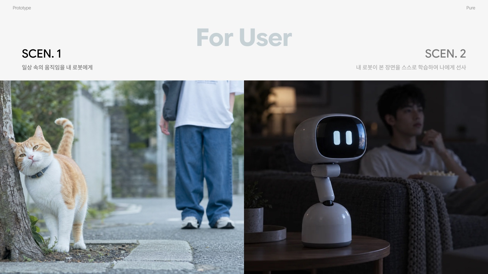

### SCEN. 1 — 일상 속의 움직임을 내 로봇에게

길에서 마주친 고양이의 반가운 몸짓을 찍어 앱에 보여주면, 그 움직임이 바로 내 로봇의 모션체가 돼요.

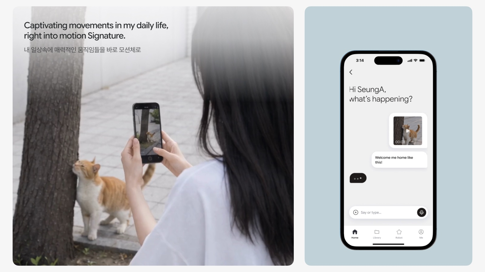

"조금 더 귀엽고 몽글몽글하게!"처럼 나만의 표현을 섞어 더 개성 있는 모션을 만들 수 있어요.

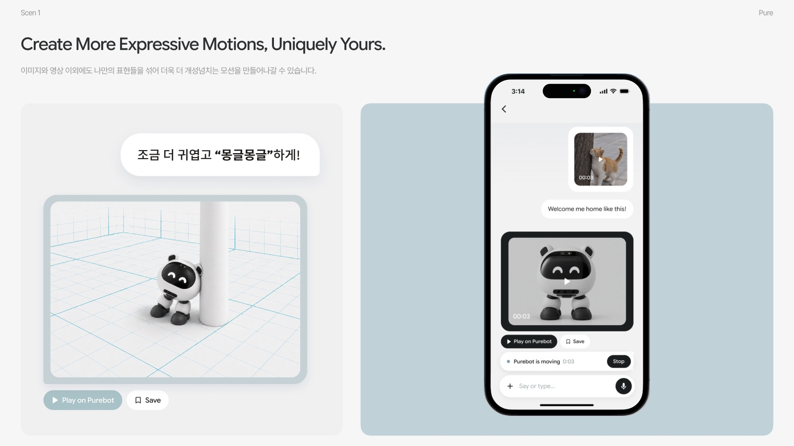

만든 모션은 저장해 두고 "누가 집에 오면 자동으로" 같은 반응 상황에 연결하면, 로봇의 행동으로 돌아와요.

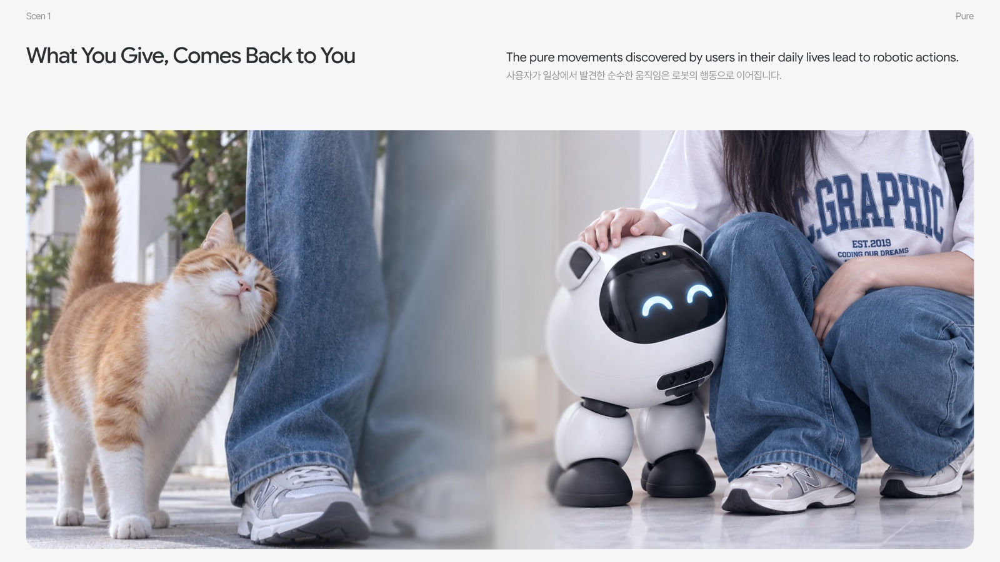

### SCEN. 2 — 내 로봇이 본 장면을 스스로 학습해 선사하기 <sub>(콘셉트)</sub>

PURE와 연결된 로봇이 사용자의 취향을 학습하고, 함께 본 장면에서 스스로 새로운 모션체를 만들어 주는 미래 시나리오예요. 이 저장소의 앱에는 **구현하지 않은 콘셉트**예요.

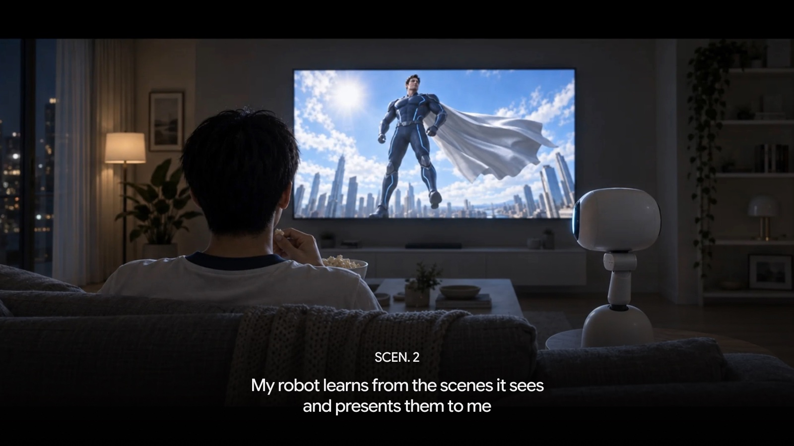

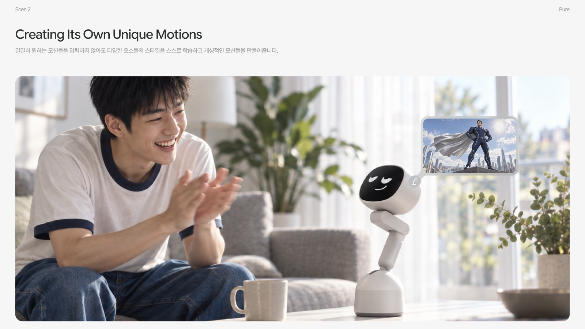

---

## ✨ 주요 기능

| | |
|---|---|
| 💬 **말로 만들기** | 상황 칩(`Someone came home` · `I'm so tired…` · `Thank you` · `That startled me!` · `What is this?`), 텍스트, 음성 입력(`speech_to_text`) |
| 🎬 **영상으로 만들기** | 앨범에서 고른 영상의 프레임을 뽑아 비전 모델에 보여주고, 그 움직임을 따라 만든 레시피를 받아요 |
| 🤖 **바로 재생** | 앱 안 WebView에서 MuJoCo(WebAssembly) 시뮬레이터가 PURE Desk(5축)를 실시간으로 움직여요 |
| ✍️ **모션 시그니처** | 성격 · 관계 · 표현 방식 세 가지 선택이 재생 속도 · 진폭 배율, 대기 모션, 인사 전 동작으로 번역돼요 |
| 📚 **라이브러리 · 자동 반응** | 마음에 든 모션을 저장하고 `Someone comes home` · `I say I'm tired` · `Something startles me` · `Only when I ask` 상황에 연결해요 |
| 🛟 **3단 폴백** | OpenAI → 로컬 모델(Ollama) → 데모 레시피. 키가 없어도, 오프라인이어도 로봇은 움직여요 |
| 🗂️ **대화 기록 · 미리보기** | 지난 대화와 생성 결과를 다시 보고, 전체 화면으로 미리 재생해요 |

---

## 📱 화면

<div align="center">

| Home | Motion Signature | Library |
|:---:|:---:|:---:|
|  |  |  |
| "Hi SeungA, what's happening?" | 고를 때마다 대기 모션이 바뀌어요 | 자동 재생 · 수동 그룹 |

| Robot | Me | Notifications |
|:---:|:---:|:---:|
|  |  |  |
| 상태 · 모드 · 시그니처 | 프로필 · 설정 | 로봇이 한 일 |

</div>

---

## 🤖 Purebot의 움직임

앱 안 시뮬레이터에서 직접 캡처한 장면이에요. 미리 검증된 **15가지 동작**과 **7가지 얼굴**을 LLM이 조합해 하나의 움직임을 만들어요.

<div align="center">

|  |  |  |
|:---:|:---:|:---:|
| `greet` | `happy` | `curious` |
|  |  |  |
| `look_around` | `nod` | `sleep` |

<sub>idle · doze · sleep · wake · nod · shake · look_around · curious · happy · sad · alert · greet · sweep · focus · home</sub>

<br/><br/>

&nbsp;
&nbsp;
&nbsp;
&nbsp;
&nbsp;
&nbsp;


<sub>`neutral` · `smile` · `heart` · `sad` · `sleepy` · `surprise` · `tilt`</sub>

</div>

---

## 🔁 파이프라인

맥락 입력(텍스트 · 이미지 · 영상) → 상태 분석 → PURE Behavior System → 출력(움직임 · 소리 · 표정) → 로봇에 적용, 그리고 사용자 반응이 다시 입력으로 돌아와요.

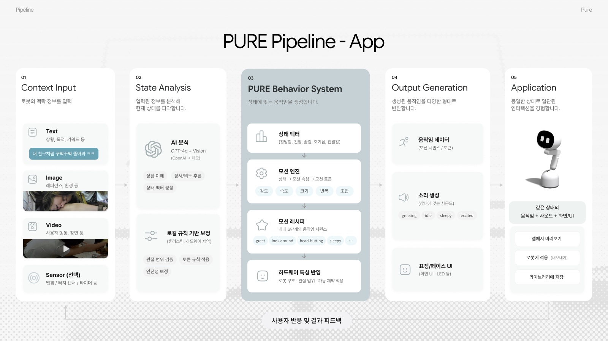

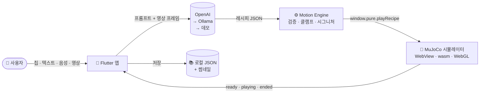

LLM은 관절 값을 직접 만들지 않아요. 대신 검증된 동작을 조합한 **레시피**를 만들어요.

```jsonc
// "Someone came home" → Purebot의 인사
{
  "steps": [
    { "behavior": "wake" , "speed": 1.1 },
    { "behavior": "greet", "speed": 1.15, "amplitude": 1.1, "repeat": 2, "face": "smile" },
    { "behavior": "happy", "speed": 1.1, "face": "heart" }
  ]
}
```

---

## 🏗️ 아키텍처

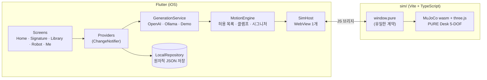

더 자세한 문서는 [`docs/architecture/`](docs/architecture/README.md)에 있어요 —
[시스템 구조](docs/architecture/01-system-architecture.md) ·
[데이터 흐름](docs/architecture/02-data-flow-diagram.md) ·
[시퀀스](docs/architecture/03-sequence-diagram.md) ·
[기능 구조](docs/architecture/04-functional-architecture.md)

<details>
<summary><b>폴더 구조</b></summary>

```
lib/
├── screens/       화면 (Home · Signature · Library · Robot · Me · 대화 기록 · 미리보기 …)
├── widgets/       Figma 디자인 시스템을 옮긴 공용 컴포넌트
├── theme/         색 · 타이포 · 간격 · 모션 토큰
├── providers/     상태 (Provider / ChangeNotifier)
├── services/
│   ├── generation/   GenerationClient — OpenAI · Ollama · Demo
│   └── …             MotionEngine · 영상 프레임 추출 · 음성 입력 · 썸네일
├── repositories/  LocalRepository (원자적 JSON 저장)
├── sim/           WebView 브리지 — SimHost · SimController
└── data/          칩 · 질문 트리 · 반응 상황 · 동작 허용 목록 · 데모 레시피 · 문구

sim/               Vite + TypeScript 시뮬레이터 (MuJoCo wasm + three.js)
└── src/api.ts     window.pure — Flutter와의 유일한 계약
```

</details>

---

## 🧰 기술 스택

| 영역 | 사용 기술 |
|---|---|
| 앱 | **Flutter** (Dart ^3.12) · iOS 14+ · Provider |
| 시뮬레이터 | **MuJoCo (WebAssembly)** · three.js · Vite + TypeScript, `flutter_inappwebview`로 앱 안에서 실행 |
| AI | **OpenAI** Chat Completions (`gpt-4o-mini` 텍스트 · `gpt-4o` 비전) → **Ollama** (`qwen3:8b`) → 데모 레시피 |
| 입력 | `image_picker` · `video_player` · `fc_native_video_thumbnail` (영상 프레임) · `speech_to_text` (음성) |
| 저장 | `path_provider` · `shared_preferences` · 로컬 JSON + 썸네일 |
| 디자인 | Figma 디자인을 토큰 기반 위젯으로 번역 · `flutter_svg` 아이콘 · Pretendard |
| 테스트 | `flutter_test` — 모션 엔진 · 생성 폴백 · 저장소 · 영상 · 음성 · 통합 · 위젯 |

---

## 🧭 설계 결정

모든 결정은 [`docs/decisions.md`](docs/decisions.md)에 한 줄씩 기록했어요.

| 결정 | 이유 |
|---|---|
| **LLM 출력은 반드시 검증** | 최대 6단계 · 동작/얼굴은 허용 목록만 · 속도 · 크기 · 반복은 범위로 클램프 (`MotionEngine`) |
| **시연 경로는 죽지 않기** | OpenAI → 로컬 모델(Ollama) → 데모 레시피 3단 폴백. 키 없음 · 오프라인 · 크레딧 소진에도 로봇은 움직여요 |
| **시뮬레이터는 봉인된 모듈** | Flutter와의 접점은 `sim/src/api.ts`의 `window.pure` 하나. WebView는 앱 전체에 1개(wasm 컴파일 비용) |
| **시그니처가 개성을 만들기** | 성격 · 관계 · 표현 방식이 재생 속도 · 진폭 배율, 대기 모션, 인사 전 동작으로 번역되어 모든 생성에 곱해져요 |
| **서버 없이** | 기기 안 JSON 파일로 저장. 영상 · 프레임은 생성 요청 외에는 앱 밖으로 나가지 않아요 |
| **로직 먼저, 디자인은 번역** | 로직을 회색 박스로 완성해 동결(`v0.1-logic`)한 뒤 Figma 화면을 토큰 기반 위젯으로 옮겼어요 |

---

## 🚀 시작하기

**요구 사항:** Flutter (Dart ^3.12) · Xcode · Node.js

```bash
git clone https://github.com/cherrymixy/pure-app.git
cd pure-app

# 1. 시뮬레이터 웹 번들 빌드 → assets/sim/
./scripts/build_sim.sh

# 2. (선택) OpenAI 키 — 없으면 Ollama · 데모로 동작해요
echo 'OPENAI_API_KEY=sk-...' > .env.local   # 값은 출력되지 않아요

# 3. iOS 시뮬레이터에서 실행
./scripts/dev.sh run
```

| 명령 | 설명 |
|---|---|
| `./scripts/dev.sh run` | 시뮬레이터에 띄우고 핫리로드 |
| `./scripts/dev.sh install` | 빌드해서 설치만 |
| `./scripts/install_device.sh` | 릴리스 빌드를 연결된 아이폰에 설치 |
| `flutter test` | 테스트 실행 |

> 🔑 OpenAI 키는 `--dart-define`으로만 주입되고 코드 · 커밋 · 로그에 남지 않아요. `.env.local`은 git에서 제외돼요.<br/>
> 같은 Wi-Fi의 Mac에서 Ollama를 띄우고 `--dart-define=OLLAMA_HOST=http://<맥 주소>:11434`를 주면 로컬 모델을 2차 생성 경로로 써요.

---

## 📎 출처 · 오픈소스

| 항목 | 출처 | 비고 |
|---|---|---|
| 물리 시뮬레이터 | [MuJoCo](https://github.com/google-deepmind/mujoco) (Google DeepMind) | `sim/public/mujoco/`의 WebAssembly 빌드를 WebView에서 실행 |
| 관절 · 채널 규칙 | [LeLamp](https://github.com/humancomputerlab/LeLamp) | 관절 이름(서보 id 1–5)을 LeLamp 규칙에 맞춤. 3D 모델 · 메시는 PURE Desk용 |
| 폰트 | [Pretendard](https://github.com/orioncactus/pretendard) | SIL Open Font License, `assets/fonts/`에 라이선스 포함 |

---

## 👥 팀


UX 설계와 검증은 셋이 함께 맡고, 제품 · 브랜드 · 인터페이스 · 모션 · 사운드 · 개발을 나눠 하나의 PURE 경험으로 이었어요.

| 이름 | 역할 |
|---|---|
| **전승아** SeungA Jeon | Sound Effect Design · Visual & UI Design · Vibe Coding(앱 · 웹 구현) |
| **최성근** Seonggeun Choi | Face UI Design · Promotion Video · Project Leading |
| **방태림** Taerim Bang | GUI Design & Prototyping · Product Design · Brand Design |
| 공통 | UX Design · Validation and QA |

<div align="center">

<br/>


**PURE** · Purebot Co. · ✉️ hongik.pure@gmail.com<br/>
📱 App · 🖥️ [Expert Lab (웹)](https://github.com/cherrymixy/pure-web)<br/>
<sub>졸업전시 프로젝트 — 실제 서비스가 아닌 시연용 결과물이에요.</sub>

</div>
