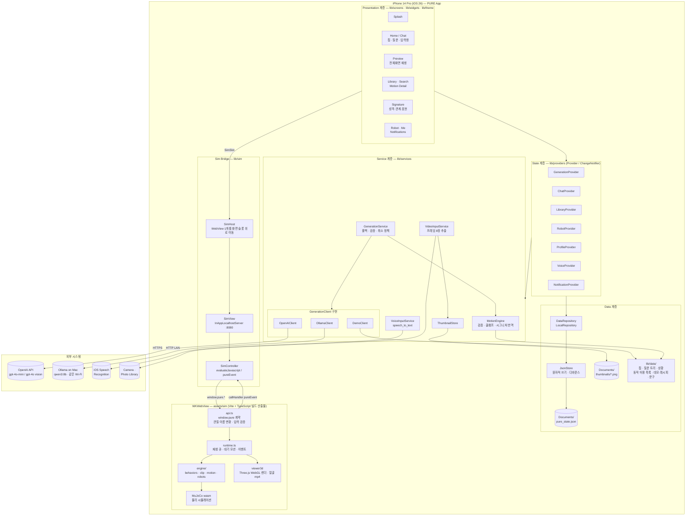
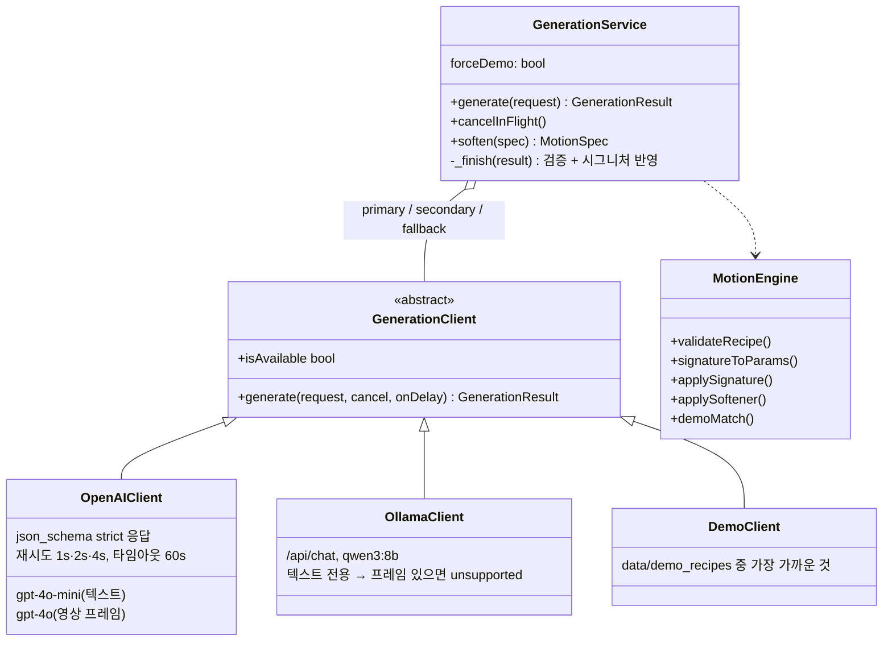

# 1. System Architecture

PURE App은 **Flutter 앱(iOS)** 과 그 안에 내장된 **웹 시뮬레이터 모듈(sim/)** 두 덩어리로 이루어진다.
앱은 계층형 구조(화면 → 상태 → 서비스 → 저장소)를 따르고, 시뮬레이터는 WebView 하나에 올라간 독립 모듈로 `window.pure` 계약으로만 통신한다.

## 1.1 전체 구성도

## 1.2 계층별 책임

| 계층 | 위치 | 책임 | 하지 않는 일 |
|---|---|---|---|
| Presentation | `lib/screens`, `lib/widgets`, `lib/theme` | Figma 시안을 토큰 기반 위젯으로 그림, 사용자 입력 수집 | 비즈니스 규칙, 색·문구 하드코딩 |
| State | `lib/providers` | 화면 상태 보관, 서비스·저장소 호출 순서 조율 | 네트워크·파일 직접 접근 |
| Service | `lib/services` | 생성 정책(폴백·취소·검증), 모션 수학, 영상·음성 입력 처리 | UI 의존 |
| Data | `lib/repositories`, `lib/data` | 영속화(JSON 파일), 정적 콘텐츠(칩·질문·허용 동작·데모 레시피·문구) | — |
| Sim Bridge | `lib/sim` | WebView 1개 생명주기, Dart ↔ JS 호출과 이벤트 변환 | 모션 계산 |
| Simulator | `sim/` → `assets/sim` | 물리 시뮬레이션, 3D 렌더, 동작 재생 | 앱 상태·생성 로직 |

## 1.3 생성 계층 구조 (Strategy + Policy 분리)

클라이언트는 "모델에 물어본다"만 알고, 폴백·검증·취소 정책은 `GenerationService` 한 곳에 모은다.
덕분에 생성 경로를 늘려도(예: Ollama 추가) 정책 코드는 바뀌지 않았다.

## 1.4 시뮬레이터 모듈과 계약

시뮬레이터는 웹 프로젝트(`_ref/pure-web`, Next.js)에서 필요한 부분만 추출해 Vite + TypeScript로 다시 묶은 것이다.
빌드 산출물은 `assets/sim/`에 들어가고, 앱 안의 로컬 HTTP 서버(`InAppLocalhostServer`, 포트 8080)가 WebView에 제공한다.

| `window.pure` 함수 | 역할 |
|---|---|
| `playBehavior(name, {speed, amplitude})` | 동작 15종 중 하나 재생 |
| `playRecipe({steps[≤6], loop}, params)` | 레시피(동작 조합) 재생 — 기본 경로 |
| `playClip({format:'lelamp.clip/1', duration, tracks})` | 관절별 키프레임 재생 — 실험 경로 |
| `setIdle({behavior, speed, amplitude})` | 대기 모션 지정 (시그니처 반영) |
| `setFace(name)` | 얼굴 화면 7종 전환 |
| `stop()` · `setView()` · `enableOrbit()` · `capture()` | 정지, 카메라, 썸네일 캡처 |
| 이벤트 `ready` / `playing` / `ended` / `error` | JS → Dart (`callHandler('pureEvent')`) |

계약 계층이 하는 일:
1. **관절 이름 변환** — 외부 이름(`base_yaw, shoulder_pitch, elbow_pitch, head_pan, head_tilt`) ↔ 엔진 내부 채널(`base_yaw, base_pitch, elbow_pitch, wrist_roll, wrist_pitch`) ↔ MuJoCo `robot.xml` 서보 1~5.
2. **입력 검증** — 범위 밖 값이나 모르는 동작·얼굴은 조용히 0으로 만들지 않고 예외를 던진다. Dart 쪽 `SimController`가 이를 `SimCallException`으로 올린다.
3. **ready 시 관절 한계 전달** — 관절 범위를 런타임에 앱으로 넘겨 앱과 시뮬이 같은 값을 쓴다.

### WebView를 하나만 쓰는 이유
MuJoCo wasm 컴파일과 3D 씬 준비에 시간이 걸리므로 앱 전체에서 WebView를 한 번만 만든다.
`SimHost`가 앱 최상단에 WebView를 띄워 두고, 각 화면은 `SimSlot` 위젯으로 "여기에 보여 달라"는 자리만 요청한다. 보이는 슬롯이 없으면 화면 밖으로 옮겨 둔다. 스플래시가 떠 있는 동안 뒤에서 wasm이 올라간다.

## 1.5 기술 스택

| 영역 | 사용 기술 |
|---|---|
| 앱 | Flutter 3.44 / Dart 3.12, Provider |
| 시뮬레이터 | Vite + TypeScript, MuJoCo (WebAssembly), Three.js (WebGL) |
| 앱 ↔ 시뮬 | flutter_inappwebview (`InAppLocalhostServer`, `evaluateJavascript`, JavaScript handler) |
| 생성 | OpenAI Chat Completions (`gpt-4o-mini`, 영상은 `gpt-4o`, `json_schema` strict), Ollama `/api/chat` (`qwen3:8b`) |
| 입력 | speech_to_text (en_US), image_picker, fc_native_video_thumbnail (프레임 추출) |
| 저장 | path_provider + JSON 파일(`pure_state.json`, 원자적 rename 쓰기) |
| 기타 | wakelock_plus (전시 중 화면 꺼짐 방지), http |
| 설정 주입 | `--dart-define` (OPENAI_API_KEY, OPENAI_MODEL, OPENAI_VISION_MODEL, OLLAMA_HOST, OLLAMA_MODEL) — 키는 코드·파일에 두지 않음 |
| 대상 기기 | iPhone 14 Pro (393×852pt), 최소 iOS 14.0 |
