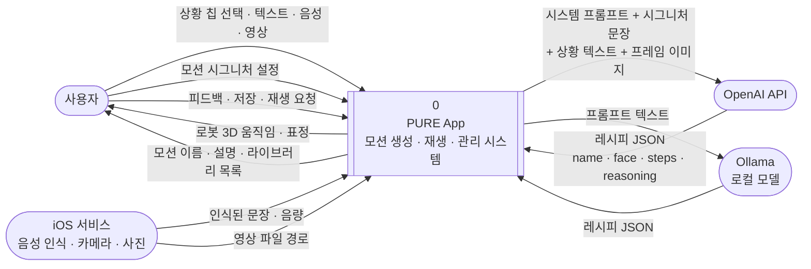
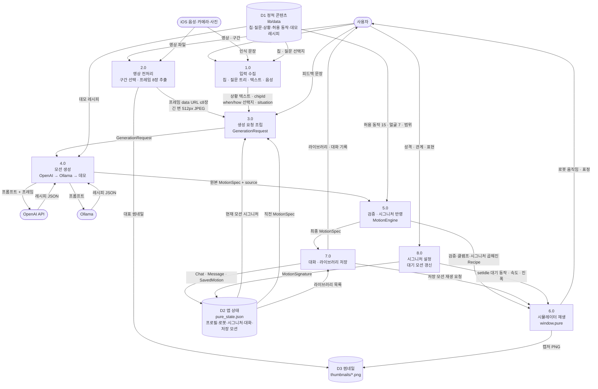
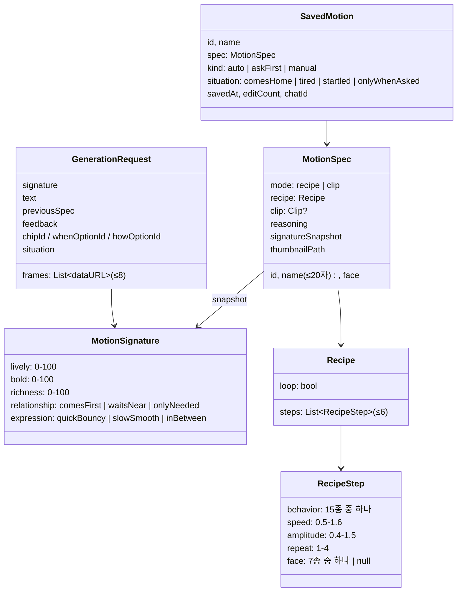

# 2. Data Flow Diagram (DFD)

표기: `([ ])` 외부 개체 · `[ ]` 처리(Process) · `[( )]` 데이터 저장소 · 화살표 라벨 = 흐르는 데이터

## 2.1 Level 0 — Context Diagram

시스템 전체를 하나의 처리로 보고, 바깥과 주고받는 데이터만 표시한다.

## 2.2 Level 1 — 주요 처리 분해

## 2.3 처리별 설명

| 번호 | 처리 | 입력 | 출력 | 구현 위치 |
|---|---|---|---|---|
| 1.0 | 입력 수집 | 칩 5종, 질문 트리 답(언제/어떻게), 자유 텍스트, 음성 | 상황 텍스트, `chipId`, `whenOptionId`, `howOptionId`, `Situation` | `home_screen`, `composer`, `VoiceInputService`, `data/question_tree` |
| 2.0 | 영상 전처리 | 갤러리/촬영 영상(≤30초), 선택 구간 | 균등 간격 프레임 8장(data URL), 썸네일 | `VideoInputService` |
| 3.0 | 요청 조립 | 1.0·2.0 결과 + 현재 시그니처 + (피드백 시) 직전 결과 | `GenerationRequest` | `home_screen` → `GenerationProvider` |
| 4.0 | 모션 생성 | `GenerationRequest` | `GenerationResult` (spec, source, raw) | `GenerationService` + 클라이언트 3종 |
| 5.0 | 검증·반영 | 원본 레시피 | 안전한 레시피(동작 허용 목록, 단계 ≤6, speed 0.5–1.6, amplitude 0.4–1.5, repeat 1–4) × 시그니처 배율 | `MotionEngine` |
| 6.0 | 재생 | 레시피 JSON, 얼굴 이름 | 3D 움직임, `playing`/`ended` 이벤트, 캡처 이미지 | `SimController` → `window.pure` |
| 7.0 | 저장 | 최종 `MotionSpec`, 이름, 반응 방식(Auto/Ask/Manual), 상황 | `SavedMotion`, 대화 기록 | `ChatProvider`, `LibraryProvider`, `LocalRepository` |
| 8.0 | 시그니처 | 성격·관계·표현 선택 | `MotionSignature`, 대기 모션 | `signature_screen`, `RobotProvider`, `MotionEngine.signatureToParams` |

## 2.4 주요 데이터 구조

## 2.5 시그니처가 숫자로 바뀌는 방식

모션 시그니처는 LLM 프롬프트에 **문장**으로 들어가고(결과의 성격을 유도), 동시에 생성 결과에 **배율**로 곱해진다(결과를 확실히 맞춤).

| 시그니처 축 | 변환 | 값 |
|---|---|---|
| lively (성격) | 재생 속도 | 0.7 → 1.4 선형 보간 |
| expression | 속도 계수 | Quick & bouncy ×1.2 · Slow & smooth ×0.8 · In between ×1.0 |
| bold (성격) | 진폭 | 0.6 → 1.3 선형 보간 |
| richness | 진폭 계수 | 0.85 → 1.15 |
| 성격 | 대기 모션 | bold ≥ 70 → `curious` · lively ≥ 55 → `look_around` · 그 외 `doze` |
| relationship | 인사 앞 동작 | Comes to me first → `focus` · Waits till I'm near → 없음 · Only when needed → `nod` |

최종 속도는 0.5–1.6, 진폭은 0.5–1.3으로 다시 자른다. 시뮬레이터에 배율을 또 넘기면 두 번 곱해져 관절 한계를 넘기 때문에, 배율은 레시피에 **미리 한 번만** 곱한다.

## 2.6 데이터가 머무는 곳

| 데이터 | 저장 위치 | 외부 전송 |
|---|---|---|
| 프로필·로봇·시그니처·대화·저장 모션·설정 | 앱 Documents `pure_state.json` (임시 파일 → rename 원자적 쓰기, 120ms 디바운스) | 없음 |
| 썸네일 | 앱 Documents `thumbnails/*.png` | 없음 |
| 영상 원본 | iOS 사진 앱/임시 파일 (앱이 복사하지 않음) | 없음 |
| 영상 프레임 | 메모리(data URL) | OpenAI 요청 본문에만 포함 |
| 음성 | iOS 음성 인식 서비스 → 문장만 앱으로 | 문장이 프롬프트에 포함 |
| OpenAI 키 | 빌드 시 `--dart-define` | Authorization 헤더 |
