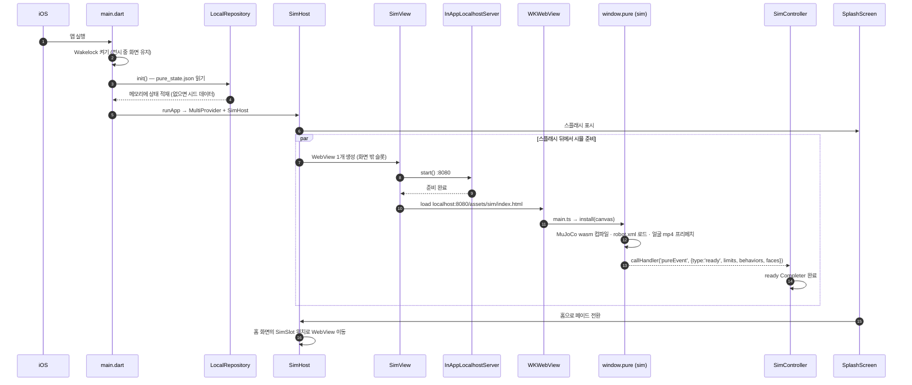
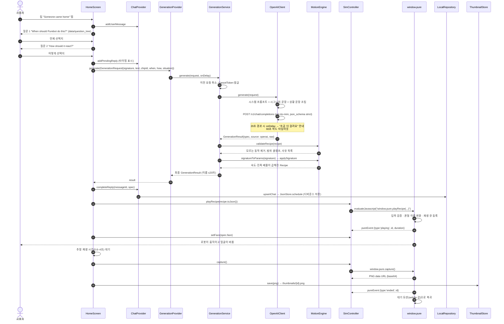
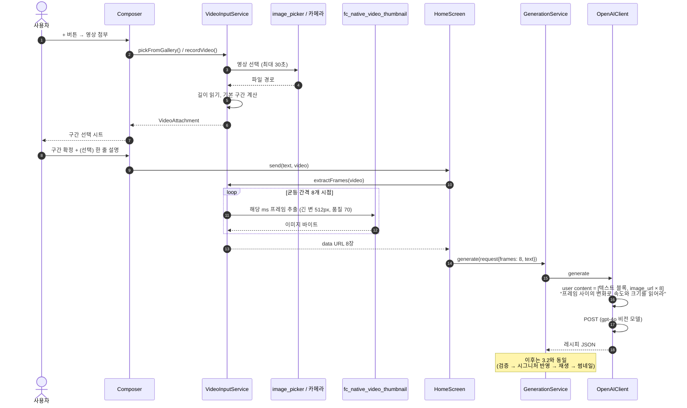
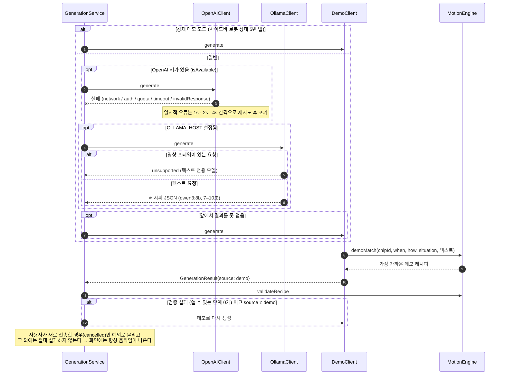
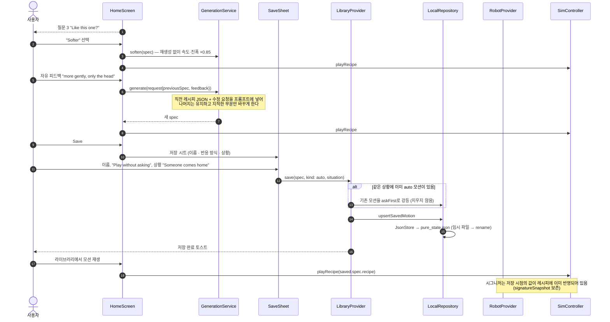

# 3. Sequence Diagram

핵심 시나리오 다섯 개를 시간 순서로 정리한다.

1. 앱 부팅과 시뮬레이터 준비
2. 상황 칩 → 질문 → 모션 생성 → 재생 (기본 시연 경로)
3. 영상 입력으로 생성
4. 생성 실패 시 3단 폴백
5. 피드백 재생성과 라이브러리 저장

---

## 3.1 앱 부팅과 시뮬레이터 준비

---

## 3.2 상황 칩 → 질문 → 생성 → 재생 (기본 경로)

---

## 3.3 영상 입력으로 생성

---

## 3.4 생성 실패 시 3단 폴백

---

## 3.5 피드백 재생성과 라이브러리 저장

