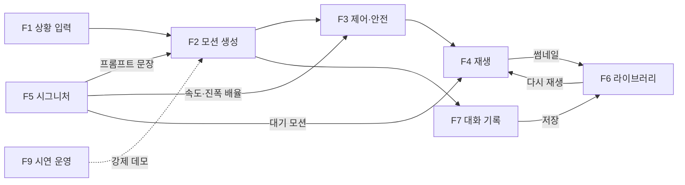

# 4. Functional Architecture

시스템이 **무엇을 하는가**를 기능 단위로 분해하고, 각 기능이 어느 모듈에서 구현되는지 대응시킨다.

## 4.1 기능 분해도

```mermaid
flowchart LR
  ROOT((PURE App))

  ROOT --> F1[F1 상황 입력]
  ROOT --> F2[F2 모션 생성]
  ROOT --> F3[F3 모션 제어·안전]
  ROOT --> F4[F4 시뮬레이션·재생]
  ROOT --> F5[F5 모션 시그니처]
  ROOT --> F6[F6 라이브러리]
  ROOT --> F7[F7 대화 기록]
  ROOT --> F8[F8 로봇·계정·알림]
  ROOT --> F9[F9 시연 운영]

  F1 --> F11[F1.1 상황 칩 5종]
  F1 --> F12[F1.2 질문 트리<br/>언제 → 어떻게 → 확인]
  F1 --> F13[F1.3 자유 텍스트]
  F1 --> F14[F1.4 음성 입력<br/>en_US · 파형]
  F1 --> F15[F1.5 영상 입력<br/>촬영·갤러리 · 구간 선택]

  F2 --> F21[F2.1 프롬프트 조립<br/>시그니처 문장 + 상황]
  F2 --> F22[F2.2 OpenAI 생성<br/>텍스트 · 비전]
  F2 --> F23[F2.3 로컬 모델 생성<br/>Ollama]
  F2 --> F24[F2.4 데모 매칭]
  F2 --> F25[F2.5 피드백 재생성 · Softer]
  F2 --> F26[F2.6 취소 · 지연 안내]

  F3 --> F31[F3.1 허용 목록 검증<br/>동작 15 · 얼굴 7]
  F3 --> F32[F3.2 범위 클램프<br/>speed · amplitude · repeat · 단계 수]
  F3 --> F33[F3.3 관절 한계 보호<br/>시뮬 계약 검증]
  F3 --> F34[F3.4 이름 자동 제안]

  F4 --> F41[F4.1 레시피 재생]
  F4 --> F42[F4.2 얼굴 표정 전환]
  F4 --> F43[F4.3 대기 모션]
  F4 --> F44[F4.4 전체화면 미리보기 · 루프]
  F4 --> F45[F4.5 썸네일 캡처]
  F4 --> F46[F4.6 키프레임 클립 재생<br/>실험 · 기본 off]

  F5 --> F51[F5.1 성격<br/>Calm · Lively · Bold]
  F5 --> F52[F5.2 관계<br/>먼저 다가옴 · 가까이 오면 · 필요할 때만]
  F5 --> F53[F5.3 표현<br/>Quick · Slow · In between]
  F5 --> F54[F5.4 배율·대기 모션 번역]

  F6 --> F61[F6.1 저장<br/>이름 · 반응 방식 · 상황]
  F6 --> F62[F6.2 반응 상황 4종 관리<br/>Auto 충돌 시 강등]
  F6 --> F63[F6.3 검색 · 필터]
  F6 --> F64[F6.4 상세 · 재생 · 수정 · 삭제]

  F7 --> F71[F7.1 대화 저장 · 이어하기]
  F7 --> F72[F7.2 대화 목록]

  F8 --> F81[F8.1 로봇 모드 · 기기 목록]
  F8 --> F82[F8.2 활동 기록]
  F8 --> F83[F8.3 펌웨어 화면]
  F8 --> F84[F8.4 프로필 · 계정 · 도움말]
  F8 --> F85[F8.5 알림 · 알림 설정]

  F9 --> F91[F9.1 강제 데모 모드 토글]
  F9 --> F92[F9.2 데모 상태 배너]
  F9 --> F93[F9.3 시뮬 자체검사 · 디버그 화면]
  F9 --> F94[F9.4 화면 꺼짐 방지]
```

## 4.2 기능 ↔ 모듈 대응표

| 기능 | 화면 (Presentation) | 상태 (Provider) | 서비스·데이터 |
|---|---|---|---|
| F1 상황 입력 | `home_screen`, `composer` | `ChatProvider`, `VoiceProvider` | `VoiceInputService`, `VideoInputService`, `data/chips`, `data/question_tree` |
| F2 모션 생성 | `home_screen` | `GenerationProvider` | `GenerationService`, `OpenAIClient`, `OllamaClient`, `DemoClient`, `data/demo_recipes` |
| F3 제어·안전 | — | — | `MotionEngine`, `data/behaviors`, `sim/src/api.ts` |
| F4 재생 | `home_screen`, `preview_screen`, `motion_detail_screen` | — | `SimHost`, `SimView`, `SimController`, `ThumbnailStore`, `sim/` |
| F5 시그니처 | `signature_screen`, `robot_screen` | `RobotProvider` | `MotionEngine.signatureToParams`, `data/signature_options` |
| F6 라이브러리 | `library_screen`, `library_search_screen`, `motion_detail_screen`, `save_sheet` | `LibraryProvider` | `LocalRepository`, `data/situations` |
| F7 대화 기록 | `chat_history_screen`, `pure_sidebar` | `ChatProvider` | `LocalRepository` |
| F8 로봇·계정·알림 | `robot_screen`, `me_screen` | `RobotProvider`, `ProfileProvider`, `NotificationProvider` | `data/robot_modes`, `data/robot_devices`, `data/seed` |
| F9 시연 운영 | `pure_sidebar`, `pure_banner`, `sim_debug_screen` | `GenerationProvider` | `Env`, `wakelock_plus` |

## 4.3 기능 간 의존 관계

## 4.4 콘텐츠 사양 (data/)

| 항목 | 값 |
|---|---|
| 상황 칩 5 | Someone came home · I'm so tired… · Thank you · That startled me! · What is this? |
| 반응 상황 4 | Someone comes home · I say I'm tired · Something startles me · Only when I ask |
| 반응 방식 3 | Play without asking (Auto) · Ask before playing · Only when I ask (Manual) |
| 동작 15 | idle doze sleep wake nod shake look_around curious happy sad alert greet sweep focus home |
| 얼굴 7 | neutral smile heart sad sleepy surprise tilt |
| 관절 5 | base_yaw · shoulder_pitch · elbow_pitch · head_pan · head_tilt |
| 레시피 한계 | 단계 ≤ 6 · speed 0.5–1.6 · amplitude 0.4–1.5 · repeat 1–4 |

## 4.5 품질 속성과 이를 보장하는 장치

| 품질 속성 | 요구 | 장치 |
|---|---|---|
| 가용성 (시연이 멈추지 않음) | 키 없음·오프라인·크레딧 소진에도 움직임이 나와야 함 | 3단 폴백, `GenerationService`는 취소 외에 예외를 던지지 않음, 강제 데모 토글 |
| 안전성 (로봇이 이상하게 움직이지 않음) | LLM 출력이 관절 한계를 넘거나 없는 동작을 부르면 안 됨 | 동작 조합(레시피) 방식, `MotionEngine` 허용 목록·클램프, 시뮬 계약의 2차 검증 |
| 응답성 | 생성 대기 체감 최소화 | 20초 지연 안내, 60초 타임아웃, 새 전송 시 이전 요청 취소, 스플래시 동안 wasm 선로딩 |
| 데이터 무결성 | 전시 중 앱이 죽어도 라이브러리가 남아야 함 | 임시 파일 → rename 원자적 쓰기, 깨진 파일은 빈 상태로 복구 |
| 성능 | wasm 재컴파일 비용 회피 | WebView 1개를 화면 간 이동 (`SimHost`/`SimSlot`) |
| 프라이버시 | 영상·키 유출 방지 | 프레임은 API 요청에만, 키는 `--dart-define`으로만 주입 |
| 유지보수성 | 시뮬과 앱의 독립 | `window.pure` 단일 계약, sim/ 봉인, 생성 정책/전송 분리 |
