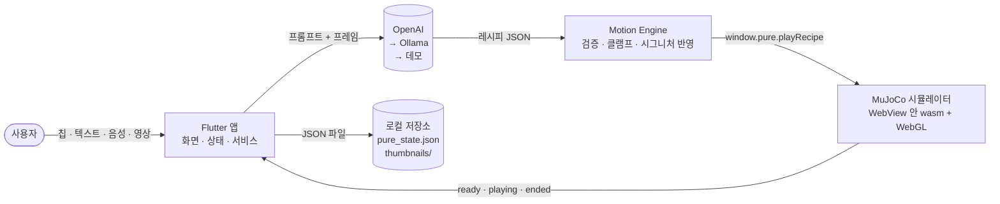

# PURE App — 기술 구조 문서

> Motion, made uniquely yours.
> 상황을 말하거나(칩·텍스트·음성) 영상을 보여주면 LLM이 PURE Desk 로봇의 움직임을 만들고,
> 앱 안의 MuJoCo 물리 시뮬레이터가 그 움직임을 실시간으로 재생 → 저장 → 라이브러리로 관리한다.

기준 시점: 2026-10-13 · `main` 브랜치 (STEP 25 마감까지 반영)

## 문서 목록

| # | 문서 | 무엇을 보여주는가 |
|---|---|---|
| 1 | [System Architecture](01-system-architecture.md) | 앱을 구성하는 계층·모듈과 외부 시스템, 기술 스택 |
| 2 | [Data Flow Diagram](02-data-flow-diagram.md) | 입력(말·영상)이 로봇 움직임과 저장 데이터가 되기까지의 데이터 흐름 (Level 0 / Level 1) |
| 3 | [Sequence Diagram](03-sequence-diagram.md) | 앱 부팅, 텍스트 생성·재생, 영상 입력, 폴백, 저장 시나리오의 시간 순서 |
| 4 | [Functional Architecture](04-functional-architecture.md) | 기능 분해도와 기능 ↔ 모듈 대응표 |

브라우저에서 한 번에 보려면 [`index.html`](index.html)을 연다 (다이어그램 렌더링에 인터넷 연결 필요).

## 한눈에 보는 구조

## 핵심 설계 결정 요약

1. **LLM은 관절 값을 직접 만들지 않는다.** 미리 검증된 동작 15종을 조합한 "레시피"(최대 6단계, 속도·크기·반복·표정)만 만든다. 결과는 `MotionEngine`이 허용 목록·범위로 검증한다.
2. **시연 경로가 죽지 않는다.** 생성은 OpenAI → 로컬 모델(Ollama) → 데모 레시피 3단 폴백. 키 없음·오프라인·크레딧 소진·잘못된 응답 모두 결국 움직임이 나온다.
3. **시뮬레이터는 봉인된 모듈이다.** Flutter와 시뮬레이터의 접점은 `sim/src/api.ts`가 노출하는 `window.pure` 하나뿐이다. WebView 인스턴스도 앱 전체에 하나(wasm 컴파일 비용).
4. **모션 시그니처가 개성을 만든다.** 성격·관계·표현 방식 설정이 재생 속도·진폭 배율, 대기 모션, 인사 앞 동작으로 번역되어 모든 생성 결과에 미리 곱해진다.
5. **서버가 없다.** 졸업전시 시연용이라 배포·계정 서버 없이 기기 안 JSON 파일로 저장한다. 영상·프레임은 API 전송 외에는 앱 밖으로 나가지 않는다.

## 진행 현황

| 구분 | 단계 | 상태 |
|---|---|---|
| 로직 | 1 스캐폴드 · 2 sim 추출 · 3 브리지 · 4 모델·콘텐츠 · 5 저장·상태 · 6 시그니처·모션 엔진 · 7 GPT 생성+데모 · 8 영상 입력 · 9 음성 입력 · 10 회색박스 · 11 통합테스트 | 완료 |
| 실험 | 12 directClip (LLM이 관절 키프레임을 직접 생성) | 데이터 모델·검증(`validateClip`)·시뮬 계약(`playClip`)까지 있음. 앱 생성 경로에는 연결하지 않음(기본 off) |
| 디자인 | 20 토큰 · 21 폰트·에셋 · 22 Figma 화면 번역 · 23 폴리시 · 24 연출 · 25 마감·실기기 | 완료 |
| 추가 | 로컬 모델(Ollama) 2차 생성 경로 | 완료 |

테스트: `test/` 아래 9개 파일, 205개 케이스 (모션 엔진 · 데이터 · 생성 폴백 · 저장소 · 영상 · 음성 · 통합 · 위젯).
설계 결정의 전체 이력은 [`docs/decisions.md`](../decisions.md)에 있다.
